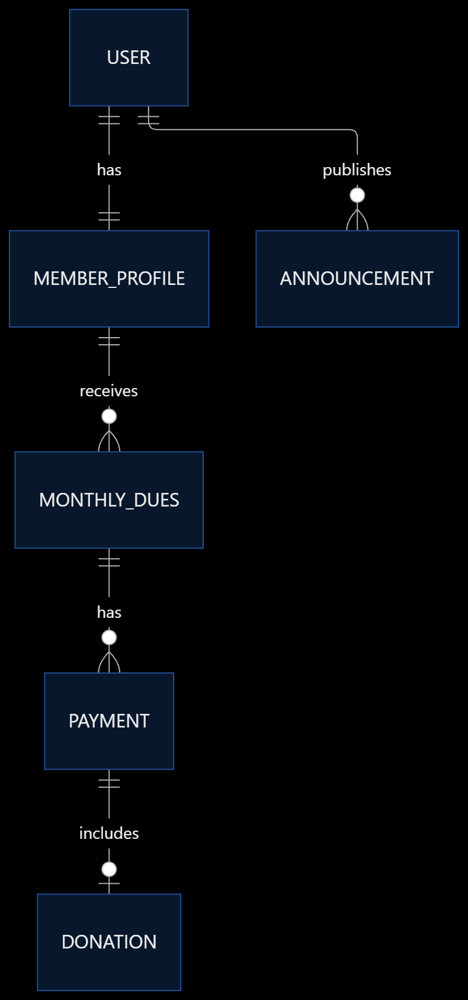

# PRD: Filipino Club Membership and Dues  

**Student:** Mark Michael Morley 
**Version:** 1.0, 11/15/2026
**Due:** day 3 of week 1. Do not start building your own models until you have feedback on this document.

> Delete the hints in _italics_ as you fill in each section. Be specific to **your** problem: a PRD that could describe any app will be sent back.

---

## 1. Problem and User

The Filipino Club currently manages its membership information and dues payments using spreadsheets and manual records. This approach can make it difficult for club officers and the treasurer to keep track of which members have paid and which members still have outstanding dues. Payment records can also become scattered or difficult to find, making it time-consuming to prepare financial reports. In addition, members may have difficulty checking their own payment history. The Club Membership and Dues Management System will provide a centralized platform where club officers, the treasurer, and members can manage and access relevant membership and payment information more easily.

**Primary users:**

- **Club officers:** Manage club membership information and oversee membership and dues activities.
- **Treasurer:** Record and monitor dues payments, check unpaid balances, and prepare financial reports.
- **Members:** View their membership information and check their own payment history.

## 2. User roles

| User role | Main responsibility |
| --- | --- |
| Club Officer / Admin | Manage club members and oversee club information. |
| Treasurer | Manage dues payments and financial records. |
| Member | View personal membership and payment information. |

### Permissions table

| Feature / Permission | Club Officer / Admin | Treasurer | Member |
| --- | --- | --- | --- |
| View member list | Yes | Yes | No |
| Add new members | Yes | Yes | No |
| Edit member information | Yes | Yes | No |
| Record payments | No | Yes | No |
| View all payment records | Yes | Yes | No |
| Prepare financial reports | No | Yes | No |
| View personal payment history | Yes | Yes | Yes |
| Manage own profile | Yes | Yes | Yes |
| Publish announcements | Yes | No | No |

## 3. User Stories

| ID | User story | Priority |
| --- | --- | --- |
| US01 | As a club officer, I want to add new members so that I can maintain an updated membership list. | Must |
| US02 | As a club officer, I want to edit member information so that member records stay accurate. | Must |
| US03 | As a club officer, I want to view the member list so that I can check registered members. | Must |
| US04 | As a treasurer, I want to record payments for any registered member so that the club can maintain accurate payment records. | Must |
| US05 | As a treasurer, I want to select cash or bank transfer as the payment method so that I can record how each member paid. | Must |
| US06 | As a treasurer, I want to view paid and unpaid members so that I can identify outstanding dues. | Must |
| US07 | As a treasurer, I want to view all payment records so that I can monitor the club's financial transactions. | Must |
| US08 | As a treasurer, I want to generate financial reports so that I can review the club's collected dues. | Should |
| US09 | As a member, I want to view my payment history so that I can check my previous payments. | Must |
| US10 | As a member, I want to view and edit my own membership information so that I can keep my personal details updated. | Must |

**Acceptance criteria**

- **US01 – Add new members**
  - Given I am logged in as a club officer, when I enter valid member information and submit the form, then the system saves the new member.
  - Given required information is missing, when I submit the form, then the system displays a validation message.
- **US02 – Edit member information**
  - Given I am logged in as a club officer, when I update a member's information, then the system saves the changes.
- **US03 – View member list**
  - Given I am logged in as a club officer, when I open the member list, then the system displays registered members.
- **US04 – Record payments**
  - Given I am logged in as a treasurer, when I enter a registered member, payment amount, and payment date, then the system saves the payment record for that member.
  - Given the selected member is not registered, when I try to record a payment, then the system rejects the invalid member selection.
- **US05 – Select payment method**
  - Given I am recording a payment, when I select cash or bank transfer, then the system saves the selected payment method with the transaction.
- **US06 – View paid and unpaid members**
  - Given I am logged in as a treasurer, when I open the dues status page, then the system shows which members have paid and which members still owe dues.
- **US07 – View payment records**
  - Given I am logged in as a treasurer, when I open the payment records page, then the system displays the club's payment transactions.
- **US08 – Generate financial reports**
  - Given I am logged in as a treasurer, when I select a reporting period, then the system generates a report showing the collected dues for that period.
- **US09 – View payment history**
  - Given I am logged in as a member, when I open my payment history, then the system displays only my own payment records.
- **US10 – View and edit personal information**
  - Given I am logged in as a member, when I open my profile, then the system displays my own membership information.
  - Given I am logged in as a member, when I update my permitted personal details, then the system saves the changes without allowing me to edit another member's profile.

## 4. Business Rules

**BR01 – Payment access:** Only users with the Treasurer role can record new member payments. Other users cannot create or modify payment records.

**BR02 – Valid payment records:** Every payment must belong to a registered member, have an amount greater than zero, include a payment date, and use an accepted payment method (cash or bank transfer).

**BR03 – Minimum monthly contribution:** Each member must contribute at least ฿30 per month to satisfy the monthly dues requirement. Members may contribute more than ฿30.

**BR04 – Monthly payment status:** The system must calculate each member's total contributions for each month. A member is considered paid when their contributions for that month reach ฿30 or more. Contributions below ฿30 mean the member is still unpaid.

**BR05 – Excess contributions:** Any amount contributed above the required ฿30 for a month must be recorded as a donation. Excess contributions cannot be carried forward to satisfy the next month's dues.

## 5. Data model

The system will use the following models to store and manage membership, dues, payments, donations, and announcements. The existing Laravel User model will handle user authentication and login accounts.

### 5.1 Proposed Models

| Model | Purpose | Example fields |
| --- | --- | --- |
| MemberProfile | Stores personal information about club members. | user_id, full_name, student_id, phone |
| MonthlyDues | Tracks each member's monthly dues requirement and payment status. | member_profile_id, month, year, required_amount |
| Payment | Stores individual dues payment transactions. | monthly_dues_id, amount, payment_date, payment_method |
| Donation | Stores the donation portion of a payment separately. | payment_id, amount |
| Announcement | Stores announcements published by club officers. | user_id, title, message, published_at |

### 5.2 Relationships

- A User has one MemberProfile.
- A MemberProfile can have many MonthlyDues records.
- A MonthlyDues record can have many Payment records.
- A Payment can have one Donation record.
- A User (Club Officer / Admin) can publish many Announcements.

### 5.3 Monthly Dues and Donations

Each member must contribute at least ฿30 per month. The system will calculate the total contributions for each month.

- If the monthly total is at least ฿30, the member is marked as paid.
- If the monthly total is below ฿30, the member is marked as unpaid.
- Any amount above ฿30 is recorded as a donation.
- Extra contributions do not carry over to the following month.

### 5.4 Announcement Management

Only users with the Club Officer / Admin role can create and publish announcements. Treasurers and members can view published announcements but cannot create or edit them.

**Architecture:** _a simple diagram or list: Vue/React frontend, Laravel API, database, and where each will be hosted. Put the diagram in `docs/architecture.png`._

## 6. API plan

| Method | URL | Role | Purpose |
| --- | --- | --- | --- |
| POST | `/api/login` | guest | Log in and receive a token |
| | | | |

## 7. Frontend plan

**Framework:** _Vue.js or React (required by CLO 2), e.g. React with Vite_. **Why:** _one or two sentences_.

**Main screens:**

1. _Login_
2.

## 8. Level-up features

| Feature | Points | How it fits my app |
| --- | --- | --- |
| | | |

## 9. Out of scope

_What you will deliberately not build in 3 weeks._

-

## 10. Changelog

_Add a dated entry for every change to this plan after the Week 1 check-in._

| Date | What changed | Why |
| --- | --- | --- |
| | | |
