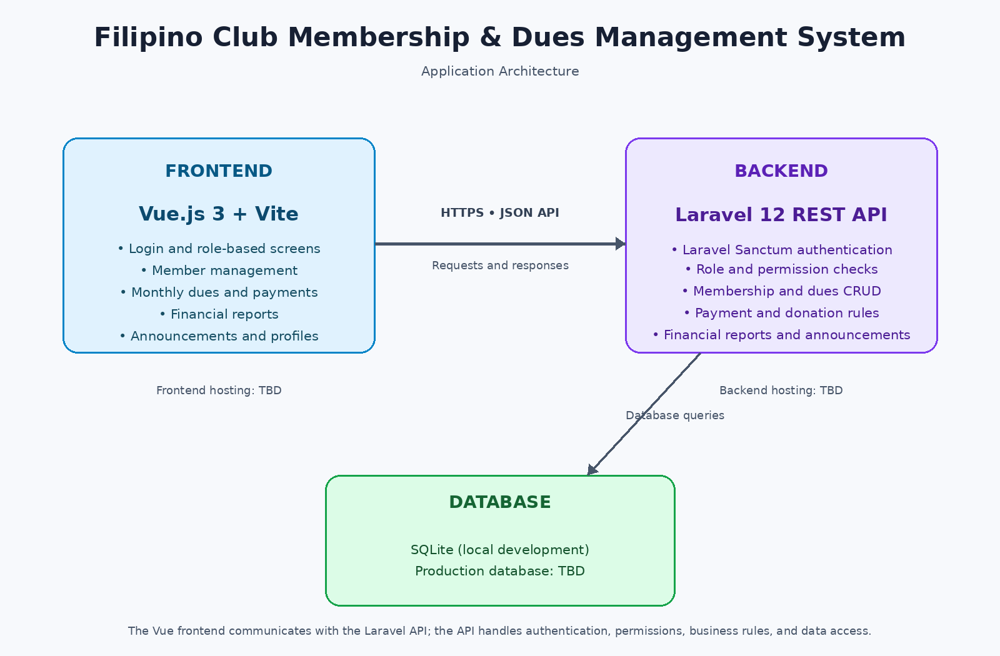

# PRD: Filipino Club Membership and Dues  

**Student:** Mark Michael Morley 
**Version:** 1.0, 11/15/2026
**Due:** day 3 of week 1. Do not start building your own models until you have feedback on this document.

> Delete the hints in _italics_ as you fill in each section. Be specific to **your** problem: a PRD that could describe any app will be sent back.

---

## 1. Problem and User

The Filipino Club currently manages its membership information and dues payments using spreadsheets and manual records. This approach can make it difficult for club officers and the treasurer to keep track of which members have paid and which members still have outstanding dues. Payment records can also become scattered or difficult to find, making it time-consuming to prepare financial reports. In addition, members may have difficulty checking their own payment history. The Club Membership and Dues Management System will provide a centralized platform where club officers, the treasurer, and members can manage and access relevant membership and payment information more easily.

**Primary users:**

- **Club officers:** Manage club membership information and oversee membership and dues activities.
- **Treasurer:** Record and monitor dues payments, check unpaid balances, and prepare financial reports.
- **Members:** View their membership information and check their own payment history.

## 2. User roles

| User role | Main responsibility |
| --- | --- |
| Club Officer / Admin | Manage club members and oversee club information. |
| Treasurer | Manage dues payments and financial records. |
| Member | View personal membership and payment information. |

### Permissions table

Anything marked "No" returns `403 Forbidden`. A request with no valid token returns `401 Unauthorized`.

| Feature / Permission | Club Officer / Admin | Treasurer | Member |
| --- | --- | --- | --- |
| View member list | Yes | Yes | No |
| View one member's details | Yes | Yes | Own profile only |
| Add new members | Yes | Yes | No |
| Edit any member's information | Yes | Yes | No |
| Edit own profile (full name, phone) | Yes | Yes | Yes |
| Remove a member (soft delete) | Yes | No | No |
| Record payments | No | Yes | No |
| View all payment records | Yes | Yes | No |
| View own payment history | Yes | Yes | Yes |
| View all monthly dues and paid/unpaid status | Yes | Yes | No |
| View own monthly dues | Yes | Yes | Yes |
| View donations | Yes | Yes | No |
| Prepare financial reports | No | Yes | No |
| View published announcements | Yes | Yes | Yes |
| View draft announcements | Yes | No | No |
| Create, edit and delete announcements | Yes | No | No |

Notes:
- "Own" means the record linked to the logged-in user's member profile. A user with no member profile has no own payments or dues to see.
- A member cannot change their own `student_id` or `role`. Those are set by an officer.
- The backend enforces every row with Policies. Hiding a button in the frontend is not security.

## 3. User Stories

| ID | User story | Priority |
| --- | --- | --- |
| US01 | As a club officer, I want to add new members so that I can maintain an updated membership list. | Must |
| US02 | As a club officer, I want to edit member information so that member records stay accurate. | Must |
| US03 | As a club officer, I want to view the member list so that I can check registered members. | Must |
| US04 | As a treasurer, I want to record payments for any registered member so that the club can maintain accurate payment records. | Must |
| US05 | As a treasurer, I want to select cash or bank transfer as the payment method so that I can record how each member paid. | Must |
| US06 | As a treasurer, I want to view paid and unpaid members so that I can identify outstanding dues. | Must |
| US07 | As a treasurer, I want to view all payment records so that I can monitor the club's financial transactions. | Must |
| US08 | As a treasurer, I want to generate financial reports so that I can review the club's collected dues. | Should |
| US09 | As a member, I want to view my payment history so that I can check my previous payments. | Must |
| US10 | As a member, I want to view and edit my own membership information so that I can keep my personal details updated. | Must |

**Acceptance criteria**

- **US01 – Add new members**
  - Given I am logged in as an officer or treasurer, when I submit a valid full name, student ID and email, then the system saves the member and returns `201`.
  - Given a required field is missing, when I submit the form, then the system returns `422` with a message for each missing field and saves nothing.
  - Given the student ID or email already exists, when I submit the form, then the system returns `422` on that field and saves nothing.
  - Given I am logged in as a member, when I try to add a member, then the system returns `403`.
- **US02 – Edit member information**
  - Given I am logged in as an officer or treasurer, when I update a member's details, then the system saves the changes and returns the updated member.
  - Given I change the student ID to one that another member already has, when I submit, then the system returns `422` and keeps the old value.
  - Given the member does not exist, when I try to edit them, then the system returns `404`.
- **US03 – View member list**
  - Given I am logged in as an officer or treasurer, when I open the member list, then the system returns members 10 per page, newest first.
  - Given I search by name or student ID, when I submit the search, then only matching members are returned.
  - Given I am logged in as a member, when I open the member list, then the system returns `403`.
- **US04 – Record payments**
  - Given I am logged in as a treasurer, when I submit a registered member, an amount above zero, a payment date, a method and at least one of that member's months, then the system saves the payment, its allocations and any donation, and returns `201`.
  - Given the member does not exist, the amount is zero or negative, the date is invalid, or a month belongs to another member, when I submit, then the system returns `422` on the field at fault and saves nothing.
  - Given a selected month is already fully paid, when I submit, then the system returns `422` and saves nothing.
  - Given I am logged in as an officer or a member, when I try to record a payment, then the system returns `403`.
- **US05 – Select payment method**
  - Given I am recording a payment, when I choose cash or bank transfer, then the system saves that method with the payment.
  - Given I send any other method, when I submit, then the system returns `422` on `payment_method`.
- **US06 – View paid and unpaid members**
  - Given I am logged in as a treasurer, when I open the dues status page for a month, then the system lists each member with that month's allocated total and a paid or unpaid status.
  - Given a member's allocations for the month add up to ฿30 or more, then they are shown as paid, and otherwise as unpaid.
  - Given I filter by status, when I choose unpaid, then only unpaid members are listed.
- **US07 – View payment records**
  - Given I am logged in as a treasurer or officer, when I open the payment records page, then the system lists payments 10 per page, newest first, with the member, amount, method, months covered and donation.
  - Given I filter by date range or by member, when I submit the filter, then only matching payments are listed.
- **US08 – Generate financial reports**
  - Given I am logged in as a treasurer, when I choose a month or a year, then the system returns total dues collected, total donations and the number of paid and unpaid members for that period.
  - Given a period with no payments, when I generate the report, then the totals are zero and the request still succeeds.
  - Given I am logged in as anyone else, when I request a report, then the system returns `403`.
- **US09 – View payment history**
  - Given I am logged in as a member, when I open my payment history, then the system returns only my own payments.
  - Given I request another member's payments by changing the address, when the request arrives, then the system returns `403` or `404` and shows nothing of theirs.
- **US10 – View and edit personal information**
  - Given I am logged in as a member, when I open my profile, then the system shows my own information.
  - Given I update my full name or phone, when I submit, then the system saves the change.
  - Given I send a `student_id`, `role` or `user_id`, when I submit, then the system ignores it and keeps the old values.

## 4. Business Rules

**BR01 – Payment access:** Only users with the Treasurer role can record new member payments. Other users cannot create or modify payment records.

**BR02 – Valid payment records:** Every payment must belong to a registered member, have an amount greater than zero, include a payment date, and use an accepted payment method (cash or bank transfer).

**BR03 – Minimum monthly contribution:** Each member must contribute at least ฿30 per month to satisfy the monthly dues requirement. Members may contribute more than ฿30.

**BR04 – Monthly payment status:** The system must calculate each member's total contributions for each month. A member is considered paid when their contributions for that month reach ฿30 or more. Contributions below ฿30 mean the member is still unpaid.

**BR05 – Excess contributions:** Any amount contributed above the required ฿30 for a month must be recorded as a donation. Excess contributions cannot be carried forward to satisfy the next month's dues.

### 4.1 What happens when a rule is broken

| Rule | Situation | Response | Result |
| --- | --- | --- | --- |
| BR01 | A member or admin tries to record a payment | `403 Forbidden` | Nothing is saved. |
| BR01 | A request has no valid token | `401 Unauthorized` | Nothing is saved. |
| BR02 | The member does not exist | `422` with an error on `member_profile_id` | Nothing is saved. |
| BR02 | The amount is zero, negative or not a number | `422` with an error on `amount` | Nothing is saved. |
| BR02 | The payment date is missing or invalid | `422` with an error on `payment_date` | Nothing is saved. |
| BR02 | The payment method is not `cash` or `bank_transfer` | `422` with an error on `payment_method` | Nothing is saved. |
| BR02 | `monthly_dues_ids` is empty, or a month belongs to a different member | `422` with an error on `monthly_dues_ids` | Nothing is saved. |
| BR03 / BR04 | A payment is below ฿30 for a month | `201 Created` | The payment is saved and allocated. The month stays unpaid until its allocations reach ฿30. |
| BR04 | A selected month is already fully paid | `422` with an error on `monthly_dues_ids` | Nothing is saved, so the same month is not paid twice. |
| BR05 | A payment is above what selected months still owe | `201 Created` | The excess is saved as a Donation. It is not carried to the next month. |
| BR05 | A request includes an `allocated_amount` or donation amount | Ignored | The backend always calculates both. |

## 5. Data Model

The system will use the following models to store and manage membership, dues, payments, donations, announcements, and club events.

### 5.1 Proposed Models

| Model | Purpose | Example fields |
| --- | --- | --- |
| User | Login account and role (admin, treasurer, member). | name, email, password, role |
| MemberProfile | Stores personal information about club members. Soft deleted. | user_id, full_name, student_id, phone, deleted_at |
| MonthlyDues | Tracks each member's dues requirement for one month. Unique per member, month and year. | member_profile_id, month, year, required_amount |
| Payment | Stores one payment transaction made by a member and recorded by the treasurer. | member_profile_id, recorded_by_user_id, amount, payment_date, payment_method |
| PaymentMonthlyDues (pivot) | Many-to-many link between a payment and the months it covers. Holds the part of the payment applied to each month. | payment_id, monthly_dues_id, allocated_amount |
| Donation | Stores the excess part of a payment, calculated by the backend. | payment_id, amount |
| Announcement | Stores announcements published by club officers. | author_user_id, title, message, published_at |

The existing `User` model will store login information and each user's role.

### 5.2 Relationships

- A User has one MemberProfile.
- A MemberProfile has many MonthlyDues records.
- A MemberProfile has many Payments.
- A Payment belongs to many MonthlyDues records, and a MonthlyDues record belongs to many Payments (many-to-many through `payment_monthly_dues`). The pivot stores `allocated_amount`, the part of the payment applied to that month.
- A Payment has at most one Donation, which holds the amount above the allocated dues.
- A User with the Treasurer role records many Payments (`recorded_by_user_id`).
- A User with the Club Officer / Admin role publishes many Announcements (`author_user_id`).

### 5.3 Monthly Dues, Allocations and Donations

Each member must contribute at least ฿30 per month (`required_amount`). A payment is not tied to one month. The treasurer chooses which months a payment covers, and the backend splits the amount:

1. For each selected month, in order, the backend rejects the request if that month is already fully paid. Otherwise, it works out what is still outstanding: `required_amount` minus the `allocated_amount` already recorded for that month.
2. It allocates the smaller of the outstanding amount and what is left of the payment, and stores it in `payment_monthly_dues.allocated_amount`.
3. Whatever is left after all selected months are covered is saved as a Donation: `donation = payment.amount − sum(allocated_amount)`. No Donation row is created when the result is zero.

Monthly status follows from the allocations:

- A month is **paid** when the sum of its `allocated_amount` values reaches `required_amount` (฿30).
- A month is **unpaid** when that sum is below ฿30. Several smaller payments can add up to a paid month.
- Extra money is never carried forward to a later month. It becomes a donation.

The whole split runs in one database transaction, so a payment, its allocations and its donation are saved together or not at all. The request body never contains an allocation or donation amount. The backend calculates both.

### 5.4 Announcement Management

Only users with the Club Officer / Admin role can create, edit, or delete announcements. Treasurers and members can view published announcements but cannot create, edit, or delete them.

### 5.5 Club Event Registration

Club officers can create club events. Members can register for events and view their own registrations. Each registration will store the registration date and status.

The system will prevent a member from registering for the same event more than once. Event registration records will be stored in the EventRegistration model, which connects MemberProfile and ClubEvent and includes the additional pivot fields `registered_at` and `status`.

## 6. API Plan

The system will use a Laravel 12 REST API to handle communication between the Vue.js 3 frontend and the database. The API will use JSON responses and Laravel Sanctum for authentication. Protected endpoints will require a valid authentication token.

### 6.1 Authentication Endpoints

| Method | Endpoint | Access | Purpose |
| --- | --- | --- | --- |
| POST | `/api/register` | Public | Create a new account with the Member role and return an access token. Body: `name`, `email`, `password`, `password_confirmation`. The role is always set to `member` by the backend and is never read from the request. |
| POST | `/api/login` | Public | Authenticate a user and return an access token. |
| POST | `/api/logout` | Authenticated users | Log out the current user and revoke their token. |
| GET | `/api/user` | Authenticated users | Return the current user's account information and role. |

Registration and login are rate limited to 6 attempts per minute per IP address. Officer and treasurer accounts are not created through registration. They are created by seeding only.

Newly registered members do not automatically receive a MemberProfile; an officer or treasurer must create one before member-specific dues or payment records can be associated with the account.

### 6.2 Member Management Endpoints

| Method | Endpoint | Access | Purpose |
| --- | --- | --- | --- |
| GET | `/api/members` | Admin, Treasurer | Retrieve the list of registered members. |
| POST | `/api/members` | Admin, Treasurer | Create a new member account and profile. |
| GET | `/api/members/{id}` | Admin, Treasurer | View a specific member's information. |
| PUT | `/api/members/{id}` | Admin, Treasurer | Update a member's information. |
| DELETE | `/api/members/{id}` | Admin | Soft-delete a member profile. |
| GET | `/api/profile` | All authenticated users | View the logged-in user's own profile. |
| PUT | `/api/profile` | All authenticated users | Update the logged-in user's own profile (`full_name`, `phone`). |

### 6.3 Monthly Dues Endpoints

| Method | Endpoint | Access | Purpose |
| --- | --- | --- | --- |
| GET | `/api/monthly-dues` | Admin, Treasurer | View monthly dues records and payment statuses. |
| GET | `/api/monthly-dues/{id}` | Admin, Treasurer | View the details of a monthly dues record. |
| GET | `/api/my/monthly-dues` | All authenticated users | View the logged-in user's own monthly dues and payment status (requires a member profile). |

### 6.4 Payment Endpoints

| Method | Endpoint | Access | Purpose |
| --- | --- | --- | --- |
| GET | `/api/payments` | Admin, Treasurer | View all payment records. |
| POST | `/api/payments` | Treasurer | Record a payment for a registered member. Body: `member_profile_id`, `amount`, `payment_date`, `payment_method` (`cash` or `bank_transfer`), `monthly_dues_ids` (array of the months it covers). The backend sets `recorded_by_user_id` from the logged-in treasurer, then calculates the allocations and any donation. |
| GET | `/api/payments/{id}` | Admin, Treasurer | View payment details. |
| GET | `/api/my/payments` | All authenticated users | View the logged-in user's own payment history (requires a member profile). |

Example response: `201 Created` with the payment, its `monthly_dues` (each with `allocated_amount`) and its `donation` (or `null`).

### 6.5 Donation and Financial Report Endpoints

| Method | Endpoint | Access | Purpose |
| --- | --- | --- | --- |
| GET | `/api/donations` | Admin, Treasurer | View donation records. |
| GET | `/api/reports/monthly` | Treasurer | Generate a monthly financial report showing dues, donations, and total contributions. |
| GET | `/api/reports/annual` | Treasurer | Generate an annual financial summary. |

### 6.6 Announcement Endpoints

| Method | Endpoint | Access | Purpose |
| --- | --- | --- | --- |
| GET | `/api/announcements` | All authenticated users | View published club announcements. |
| GET | `/api/announcements/{id}` | All authenticated users (published); Admin (published or draft) | View a specific announcement. |
| POST | `/api/announcements` | Admin | Publish a new announcement. |
| PUT | `/api/announcements/{id}` | Admin | Edit an announcement. |
| DELETE | `/api/announcements/{id}` | Admin | Delete an announcement. |

### 6.7 API Security and Validation

- Users must log in before accessing protected API endpoints. Requests without a valid token return `401 Unauthorized`.
- Laravel Sanctum will handle authentication using access tokens.
- Laravel Policies will enforce role permissions and record ownership. A forbidden action returns `403 Forbidden`.
- All authenticated users can only view and update their own profile; profile edits are limited to `full_name` and `phone`.
- Own payment and dues endpoints return only records linked to the logged-in user's member profile.
- Only the Treasurer can record payments.
- Only the Admin can publish, edit, or delete announcements.
- Payment amounts, dates, and payment methods will be validated by the Laravel backend.
- The backend will calculate monthly dues and donation amounts to prevent incorrect payment records.
- All API responses will use JSON format.

## 7. Frontend Plan

The project will use Vue.js 3 with Vite for the frontend. Vue.js was selected because its template syntax is beginner-friendly and makes it easier to organize the application into reusable components.

The frontend will communicate with the Laravel 12 REST API to retrieve and manage membership, dues, payment, donation, and announcement information.

### Main Screens

1. Login page
2. Admin dashboard
3. Member management
4. Payment management
5. Monthly dues tracking
6. Financial reports
7. Announcements
8. Member profile and payment history

## 8. Level-up Features

| Feature | Points | How it fits my app |
| --- | --- | --- |
| Financial Dashboard | To be determined | Displays charts and financial summaries showing monthly dues, donations, total contributions, and unpaid members. |
| Export Financial Reports | To be determined | Allows the Treasurer to download monthly and annual financial reports in CSV or PDF format. |
| Monthly Payment Reminders | To be determined | Helps members remember their monthly dues by notifying them when their payments are still incomplete. |

These features will improve financial monitoring, reduce manual reporting work, and help members stay informed about their monthly contributions.

## 9. Out of Scope

The following features are outside the scope of this project:

1. **Online Payment Processing:** The system will not process payments through online payment gateways. The Treasurer will manually record cash and bank transfer payments.
2. **Mobile Application:** The project will focus on a web-based application that users can access through a web browser.
3. **Automatic Bank Integration:** The system will not connect directly to bank accounts or automatically verify bank transfers.
4. **Multiple Club Management:** The system will support one Filipino Club rather than managing multiple clubs or organizations.
5. **Advanced Accounting:** The system will manage membership dues, donations, and financial reports but will not provide advanced accounting or tax management features.

These limitations will help keep the project focused on its main purpose: managing club membership information, monthly dues, payments, donations, and financial reports.

## 10. Changelog

| Date | Changes |
| --- | --- |
| November 10, 2026 | Created the initial PRD and identified the problem, current management process, and primary users. |
| November 11, 2026 | Defined user roles, permissions, and the main user stories for the system. |
| November 12, 2026 | Added business rules for monthly dues, payment methods, and donations. |
| November 13, 2026 | Designed the initial data model and created the ERD and architecture diagrams. |
| November 14, 2026 | Selected Vue.js 3 with Vite for the frontend and updated the frontend architecture. |
| November 15, 2026 | Added the API plan, level-up features, and out-of-scope requirements. |
