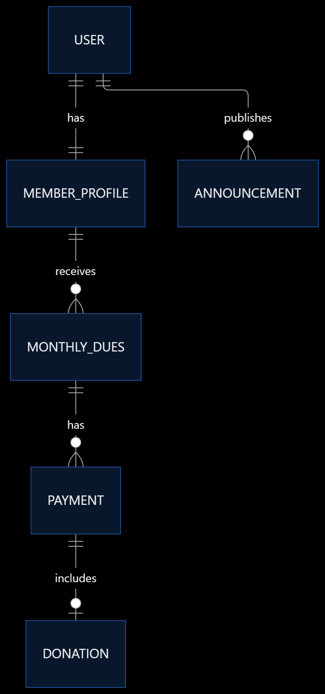

# Filipino Club Membership and Dues System

A Laravel 12 REST API for the Filipino Club. The treasurer records monthly dues payments, officers manage the club, and members check their own payments. Every payment is split by the backend: each selected month is filled up to ฿30, and any extra becomes a donation.

**Student:** Mark Michael Morley | **Course:** IT 367 Web Application Development

## Live

- **API:** [https://filipino-club-api.onrender.com/api](https://filipino-club-api.onrender.com/api) (health check: [https://filipino-club-api.onrender.com/up](https://filipino-club-api.onrender.com/up))
- **Frontend:** *coming in week 3*

The API runs on a free Render instance, so the first request after a pause can take about a minute to wake up.

## Demo logins

| Role | Email | Password | Can do |
| --- | --- | --- | --- |
| Admin (Club Officer) | `admin@example.com` | Set in Render; not published in this repository. Local: `SEED_PASSWORD` in `.env`. | Manage announcements, view all payments and dues |
| Treasurer | `treasurer@example.com` | Set in Render; not published in this repository. Local: `SEED_PASSWORD` in `.env`. | Record payments, manage monthly dues |
| Member | `member@example.com` | Set in Render; not published in this repository. Local: `SEED_PASSWORD` in `.env`. | View own payments and dues |

These accounts hold fake data only. The live demo uses a prototype account and should not contain real personal or payment information. The deployed password is configured privately in Render; do not commit it to the repository.

## Documents

| File | What it is |
| --- | --- |
| [PRD.md](PRD.md) | Problem, roles, user stories, business rules, data model, API plan |
| [Endpoints](#endpoints) | Implemented and planned API routes with their roles and status |
| [DEPLOYMENT.md](DEPLOYMENT.md) | Hosting, security controls, optimizations |
| [DECISIONS.md](DECISIONS.md) | Design decisions and why |
| [PROMPTS.md](PROMPTS.md) | AI usage log, one entry per commit |

## Setup (local)

Requirements: PHP 8.2 or newer (with `pdo_sqlite`, `mbstring`), Composer 2, SQLite (nothing to install).

```bash
git clone <your-repo-url>
cd <your-repo>

composer install
cp .env.example .env
php artisan key:generate

# Set a local demo password in .env before seeding, for example:
# SEED_PASSWORD=password

touch database/database.sqlite        # Windows PowerShell: ni database/database.sqlite
php artisan migrate:fresh --seed

php artisan test
./vendor/bin/pint --test              # ./vendor/bin/pint fixes the style
php artisan serve                     # http://127.0.0.1:8000
```

Set `SEED_PASSWORD` before seeding. If it is empty, the demo accounts are created with an empty password and cannot log in. Use a unique value for any deployed environment.

Try it:

```bash
curl -X POST http://127.0.0.1:8000/api/login \
  -H "Accept: application/json" -H "Content-Type: application/json" \
  -d '{"email":"treasurer@example.com","password":"password"}'
```

Send the returned token as `Authorization: Bearer <token>` on protected requests, with `Accept: application/json`.

## How a payment works

1. The treasurer creates a month of dues for a member (default ฿30).
2. The treasurer records a payment and chooses which months it covers.
3. The backend allocates the amount to each selected month, up to what it still owes. A month is **paid** once its allocations reach ฿30, and smaller payments add up.
4. Anything left over is saved as a donation and is never carried to the next month.
5. A payment, its allocations and its donation are saved in one transaction, so a rejected payment leaves nothing behind.

## ERD



Payments and monthly dues are linked many-to-many through `payment_monthly_dues`, which stores `allocated_amount`.

## Endpoints

Base path `/api`. Status: **Built** = implemented and tested, **Planned** = in the PRD, not built yet.

| Method | URL | Auth and role | What it does | Status |
| --- | --- | --- | --- | --- |
| GET | `/up` (no `/api`) | none | Health check | Built |
| POST | `/api/register` | none, 6 per minute | Create a Member account, returns user and token | Built |
| POST | `/api/login` | none, 6 per minute | Returns user and token | Built |
| POST | `/api/logout` | any logged-in user | Revokes the current token | Built |
| GET | `/api/user` | any logged-in user | The current user | Built |
| GET | `/api/announcements` | any logged-in user | List. Members see published only | Built |
| POST | `/api/announcements` | admin | Create | Built |
| GET | `/api/announcements/{announcement}` | any logged-in user (drafts: admin) | View one | Built |
| PUT/PATCH | `/api/announcements/{announcement}` | admin | Update | Built |
| DELETE | `/api/announcements/{announcement}` | admin | Delete | Built |
| GET | `/api/payments` | admin, treasurer | List. Filters: `member_id`, `payment_method`, `from`, `to`, `sort` | Built |
| POST | `/api/payments` | treasurer | Record a payment, split into allocations and a donation | Built |
| GET | `/api/payments/{payment}` | admin, treasurer, member (own) | View one | Built |
| GET | `/api/my/payments` | any logged-in user | Own payments | Built |
| GET | `/api/monthly-dues` | admin, treasurer | List. Filters: `month`, `year`, `member_id`, `status` | Built |
| POST | `/api/monthly-dues` | treasurer | Create a month for a member | Built |
| GET | `/api/monthly-dues/{monthly_due}` | admin, treasurer, member (own) | View one with its payments | Built |
| PUT/PATCH | `/api/monthly-dues/{monthly_due}` | treasurer | Change the required amount | Built |
| DELETE | `/api/monthly-dues/{monthly_due}` | treasurer | Delete (blocked if it has payments) | Built |
| GET | `/api/my/monthly-dues` | any logged-in user | Own dues and status | Built |
| GET | `/api/members` | admin, treasurer | List with search and sort | Planned |
| POST | `/api/members` | admin, treasurer | Create a member | Planned |
| GET | `/api/members/{member}` | admin, treasurer | View one | Planned |
| PUT | `/api/members/{member}` | admin, treasurer | Update | Planned |
| DELETE | `/api/members/{member}` | admin | Soft delete | Planned |
| GET | `/api/members/{member}/payments` | admin, treasurer | Nested: a member's payments | Planned |
| GET | `/api/profile` | any logged-in user | Own profile | Planned |
| PUT | `/api/profile` | any logged-in user | Update own name and phone | Planned |
| GET | `/api/donations` | admin, treasurer | List donations | Planned |
| GET | `/api/reports/monthly` | treasurer | Monthly totals | Planned |
| GET | `/api/reports/annual` | treasurer | Annual totals | Planned |

Payments cannot be edited or deleted. `PUT` and `DELETE` on a payment return 405.

## Business rules

| Rule | Behavior |
| --- | --- |
| BR01 | Only the treasurer can record payments (others get 403) |
| BR02 | A payment needs an existing member, an amount above 0, a date and a method of `cash` or `bank_transfer` (otherwise 422) |
| BR03 | Each member owes at least ฿30 per month |
| BR04 | A month is paid once its allocations reach ฿30 |
| BR05 | Anything above what the selected months owe becomes a donation, never carried forward |

## Level-up features

*Fill in where each one lives once built. Planned from the PRD:*

| Feature | Points | Code | Tests |
| --- | --- | --- | --- |
| Reports and charts | 6 | *planned* | *planned* |
| Queued jobs or scheduled tasks (payment reminders) | 8 | *planned* | *planned* |
| Frontend tests | 6 | *planned* | *planned* |

## Tests

`php artisan test` runs 73 tests covering authentication, announcements, payments, monthly dues and the payment service rules. CI runs Pint and the tests on every push.
